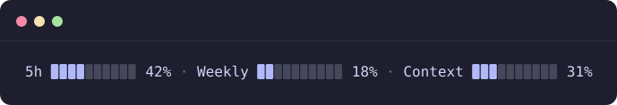

<div align="center">

# claude-statusbar

**Your Claude Code usage, always in sight.**

A tiny status line for [Claude Code](https://claude.com/claude-code) that shows your limits as bars, like `/usage`, without leaving the conversation.




</div>

## ✨ What it shows

| Bar | Meaning |
| --- | --- |
| **5h** | How much of the current 5-hour session limit you have used |
| **Weekly** | How much of the weekly limit you have used |
| **Context** | How much of this conversation's context window is filled |

Each bar has 10 cells, so one cell is about 10%.

## 🚀 Install

```bash
git clone https://github.com/zangetsuo/claude-statusbar.git
cd claude-statusbar
./install.sh
```

The bar appears after the next reply in Claude Code.

**Requirements:** `bash` and [`jq`](https://jqlang.github.io/jq/) (`brew install jq` on macOS, `sudo apt install jq` on Debian/Ubuntu).

## 🔒 What the installer touches

- Copies `statusline-command.sh` to `~/.claude/`.
- Sets the `statusLine` entry in `~/.claude/settings.json`. Every other setting stays as it is.
- Saves a backup of `settings.json` before changing it.
- Asks before replacing a status line you already have. Use `./install.sh --force` to skip the question.

The script only reads the JSON that Claude Code passes to status lines. It makes no network requests and reads no credentials.

## 🎨 Customize

Everything lives in `~/.claude/statusline-command.sh`:

| Want to change | Edit |
| --- | --- |
| Bar color | `38;2;177;185;249` (an RGB color: `38;2;R;G;B`) |
| Empty cell color | `38;5;240` |
| Labels | `5h`, `Weekly`, `Context` near the end of the file |

## 📝 Notes

- The **5h** and **Weekly** bars need a Claude subscription plan and show up after the first reply of a session. Until then you see **Context** alone, or `usage: waiting for data`.
- The default blue matches Claude Code's dark theme.

## 🗑️ Uninstall

Remove the `statusLine` entry from `~/.claude/settings.json` (or restore the backup the installer created), then delete `~/.claude/statusline-command.sh`.
